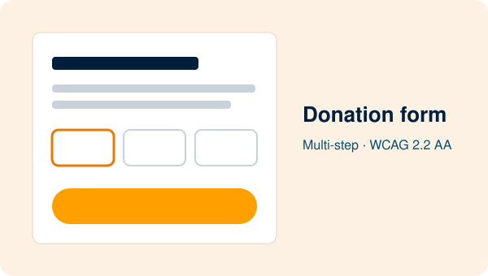
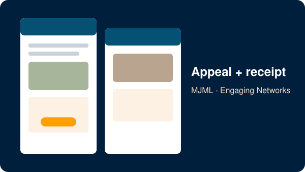

 <!--
  GitHub profile README for github.com/ShadeLourens.
  It goes in a public repo named exactly "ShadeLourens", with the images in assets/.
  GitHub removes <style>, classes and most inline styles, so the design lives in the images.
  The banners are animated SVGs (CSS keyframes, switched off for reduced motion); the cards are static.
-->

<!-- Banner: GitHub shows the dark version to people using its dark theme -->
<picture>
  <source media="(prefers-color-scheme: dark)" srcset="assets/banner-dark.svg">
  <source media="(prefers-color-scheme: light)" srcset="assets/banner-light.svg">
  
</picture>

I'm a frontend developer with a design background. I spent years designing for agencies and brands in South Africa and Denmark, and in 2024 I started building what I design. I finished HyperionDev's Full Stack Web Developer programme first of 38.

Right now I build production UI and email templates for a hospitality SaaS, and a fundraising portfolio for a fictional animal charity: an accessible donation form and the emails that go with it.

## Selected work

<table>
  <tr>
    <td width="50%" valign="top">
      
      
<strong>Donation form</strong> 
      A multi-step donation form for a fictional animal charity. Plain HTML, CSS and JavaScript, built to WCAG 2.2 AA and tested with a keyboard, VoiceOver, axe and Lighthouse.

      
<a href="https://shadelourens.github.io/fernhollow-portfolio/">Live demo</a> · <a href="https://github.com/ShadeLourens/fernhollow-portfolio">Code</a>

    </td>
    <td width="50%" valign="top">
      
      
<strong>Appeal and receipt emails</strong> 
      Two emails written in MJML and built for Engaging Networks, tested in Gmail, Apple Mail, Outlook.com and classic Outlook on Windows.

      
<a href="https://shadelourens.github.io/fernhollow-emails/">Previews</a> · <a href="https://github.com/ShadeLourens/fernhollow-emails">Code</a>

    </td>
  </tr>
</table>

<!-- When the petition page is live, add a second row like the one above -->

## What I work with

**Build:** HTML · CSS · JavaScript · TypeScript · React · Next.js · Node.js · Express · MongoDB 
**Email:** MJML · Jinja2 templates · Engaging Networks templates · Mailgun · Email on Acid 
**Design and tools:** Figma · Adobe Creative Suite · Git · GitHub · Vercel · Claude Code

## How I work

I build with Claude Code. It plans and writes the code, a separate Claude chat reviews each plan, and I make the final call on every change. Then I test the result myself, in real browsers, real inboxes, with a keyboard and with a screen reader.

## Find me

[LinkedIn](https://www.linkedin.com/in/shadelourens) · [Donation form](https://shadelourens.github.io/fernhollow-portfolio/) · [Emails](https://shadelourens.github.io/fernhollow-emails/)
